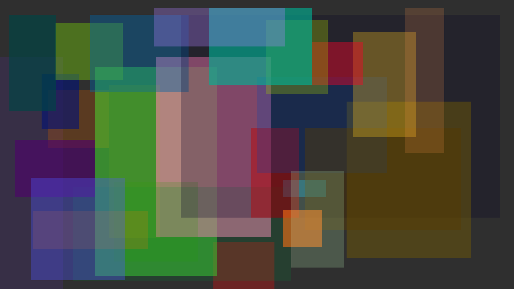

# abstract?

24 pictures

<table>
  <tr>
    <td align="center">
      <a href="src">
        
    </td>
    <td align="center">
      <a href="src">
        
    </td>
    <td align="center">
      <a href="src">
        
    </td>
    <td align="center">
      <a href="src">
        
    </td>
    <td align="center">
      <a href="src">
        
    </td>
  </tr>
  <tr>
    <td align="center">
      <a href="src">
        
    </td>
    <td align="center">
      <a href="src">
        
    </td>
    <td align="center">
      <a href="src">
        
    </td>
    <td align="center">
      <a href="src">
        
    </td>
    <td align="center">
      <a href="src">
        
    </td>
  </tr>
  <tr>
    <td align="center">
      <a href="src">
        
    </td>
    <td align="center">
      <a href="src">
        
    </td>
    <td align="center">
      <a href="src">
        
    </td>
    <td align="center">
      <a href="src">
        
    </td>
    <td align="center">
      <a href="src">
        
    </td>
  </tr>
  <tr>
    <td align="center">
      <a href="src">
        
    </td>
    <td align="center">
      <a href="src">
        
    </td>
    <td align="center">
      <a href="src">
        
    </td>
    <td align="center">
      <a href="src">
        
    </td>
    <td align="center">
      <a href="src">
        
    </td>
  </tr>
  <tr>
    <td align="center">
      <a href="src">
        
    </td>
    <td align="center">
      <a href="src">
        
    </td>
    <td align="center">
      <a href="src">
        
    </td>
    <td align="center">
      <a href="src">
        
    </td>
    <td></td>
  </tr>
</table>
<!-- This README was automatically generated with Python. -->
